# node-red-iotedge

## 目次

* [概要](#概要)
* [機能](#機能)
* [ノードの設定](#ノードの設定)
  * [環境変数](#環境変数)
  * [コンテナーの作成オプション Create Option](#コンテナーの作成オプション-create-option)
* [ノードライブラリの説明](#ノードライブラリの説明)
  * [IoTEdgeClient](#node-specification-iotedgeclient)
  * [Module Input](#node-specification-module-input)
  * [Module Output](#node-specification-module-output)
  * [Module Twin](#node-specification-module-twin)
  * [Module Method](#node-specification-module-method)
* [ログ出力内容](#ログ出力内容)
  * [IoTEdgeClient](#log-iotedgeclient)
  * [Module Input](#log-module-input)
  * [Module Output](#log-module-output)
  * [Module Twin](#log-module-twin)
  * [Module Method](#log-module-method)
* [エラー時動作一覧](#エラー時動作一覧)
  * [共通](#共通)
  * [Module Input](#error-module-input)
  * [Module Output](#error-module-output)
  * [Module Twin](#error-module-twin)
  * [Module Method](#error-module-method)
* [Feedback](#feedback)
* [LICENSE](#license)
  
## 概要

Azure IoT Edge Node-RED Moduleをベースに一部カスタムを行ったNodeRedのカスタムノードです。

## 機能

AzureのIoTEdgeとの仲介を行う。  
以下のノードを含む。

* IoTEdgeClient Azure IoT Edgeとの接続を管理するグローバル設定ノード。他の全てのノードから参照される。

  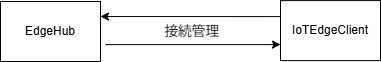

  作成方法は下記の通り。  
  ① IoTEdgeカスタムノードのプロパティを開き、右側の鉛筆マークを押す。  
  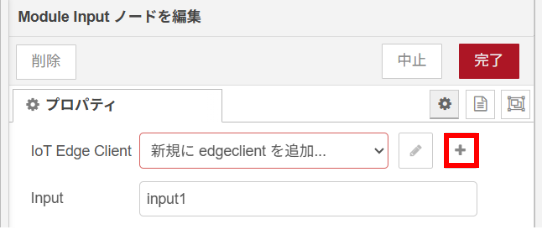  

  ② 右上の追加ボタンから追加する。  
  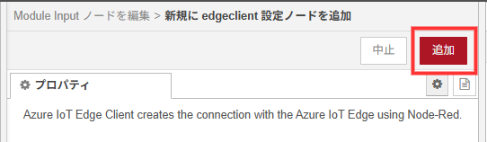

* Module Input/Module Output モジュール間のメッセージ送受信。  
外部のモジュールからのメッセージ受信、外部のモジュールへのメッセージ送信を行う。  

  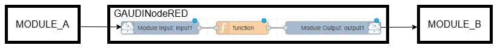

* Module Twin モジュールのdesiredプロパティ受信/reportedプロパティ送信。  

  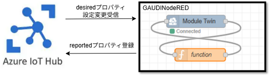

* Module Method ダイレクトメソッド実行, 結果の送信。  

  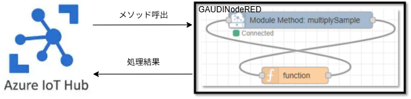

## ノードの設定

### 環境変数

本パッケージを利用するモジュールの環境変数に設定する。

#### 環境変数の値

| Key                         | Type   | Required | Conditions       | Default  | Description                                                                                                                                                                                                                                                                                                                                                                                                                                                                                                                                                                                                                                                                                                                                                     |
| --------------------------- | ------ | -------- | ---------------- | -------- | --------------------------------------------------------------------------------------------------------------------------------------------------------------------------------------------------------------------------------------------------------------------------------------------------------------------------------------------------------------------------------------------------------------------------------------------------------------------------------------------------------------------------------------------------------------------------------------------------------------------------------------------------------------------------------------------------------------------------------------------------------------- |
| AzureIoTMaxOperationTimeout | number |          | 240000以上の整数 | 86400000 | EdgeHubとの接続やメッセージ送受信等の通信において再試行が行われた際のタイムアウト時間。<br>単位はミリ秒。<br>**ネットワークの切断検知時間(約16分)と<br>本設定値の合計期間を超えてネットワークが切断状態となった場合、<br>モジュールを再起動しない限りTwin・メッセージ・DirectMethodの受信ができなくなります。<br>必ず運用に適した値を設定してください。**                                                                                                                                                                                                                                                                                                                                                                                                       |
| RetryErrorFilter            | string |          |                  |          | **トラブル回避用のため通常時は利用不可**<br>EdgeHubとの切断時エラーの種類によって再接続の要否を判定する際に用いられるフィルタが存在する。<br>この環境変数でそのフィルタに対し、エラーを新規追加もしくは判定の変更ができる。<br>現状既知のエラーは全て再接続処理に進むよう設定されている。<br>値は"エラー名=[true もしくは false]"の形で設定する。<br>設定した値以外はデフォルト(再接続処理が行われる)から変更されない。<br>true：そのエラーにより切断された時再接続処理に入る<br>false：そのエラーにより切断された時再接続処理が行われない<br>複数指定したい場合は","で繋ぐ。<br>例："xxxxxError=true,TimeoutError=false"で設定した場合はxxxxErrorがフィルタに追加、<br>TimeoutErrorがfalseに変更され、他のエラーはデフォルトのまま再接続処理される設定となる。 |

### コンテナーの作成オプション Create Option

#### コンテナーの作成オプション Create Option の値

(なし)

## ノードライブラリの説明

<a id="Node-Specification-IoTEdgeClient"></a>

### IoTEdgeClient

#### 機能概要

  Azure IoT Edge との接続を管理するグローバル設定ノード。  

本ノードは以下の機能を提供する。

* Edge Hub との 接続の確立と管理
* Module Client の作成と初期化
* Module Twin の取得と管理
* タイムアウト設定とリトライポリシーの設定
* メッセージサイズ制限の管理
* エラーフィルターの設定と管理

  本ノードは他の Module Input、Module Output、Module Twin、Module Method ノードから参照される設定ノードであり、  
  1つの Node-RED 環境に1つ作成すれば十分である。

#### プロパティ

  本ノードはグローバル設定ノードのため、フロー画面上に表示されるプロパティはない。  
  設定は環境変数によって制御される。

#### 動作概要

  1. **クライアント作成**: Azure IoT Edge の環境変数から Module Client を作成
  2. **接続確立**: Edge Hub への接続を確立し、切断時の自動再接続を管理
  3. **ツイン管理**: Module Twin の取得と状態管理を行う
  4. **エラー処理**: 接続エラーやタイムアウトエラーを適切に処理し、ログ出力を行う

<a id="Node-Specification-module-input"></a>

### Module Input

#### 機能概要

  GAUDI-NodeREDモジュールで受信した指定インプット名のメッセージから、  
  Bodyをmsg.payloadに, Propertyをmsg.propertiesにセットし、出力する。  

本ノードを通ると元のメッセージに以下の情報が付与される。  

* topicプロパティ(msg直下): "input"  
* inputプロパティ(msg直下): インプット名  
* \$.cdidプロパティ(properties配下): デバイス名  
* \$.cmidプロパティ(properties配下): 送信元モジュール名  

#### プロパティ

  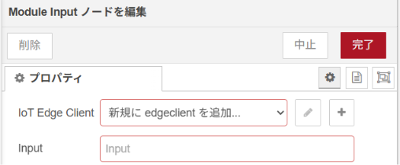
  
  | プロパティ      | Type       | Required | Conditions | default                            | Description                                                                                                         |
  | --------------- | ---------- | -------- | ---------- | ---------------------------------- | ------------------------------------------------------------------------------------------------------------------- |
  | IoT Edge Client | edgeclient | 〇       |            |                                    | 送受信を行う client のグローバル設定を選択。<br>複数作成することができるが、1つの NodeRED 環境に 1 つあれば問題ない |
  | Input           | string     | 〇       |            | 同一の名前を複数ノードに指定不可。 | インプット名。                                                                                                      |

#### 使用例１

  [プロパティ]

  | プロパティ      | Type       | Value           |
  | --------------- | ---------- | --------------- |
  | IoT Edge Client | edgeclient | IoT Edge Client |
  | Input           | string     | input1          |

  [入力メッセージ]

  ```json
  {
    "deviceId": "Edge01",
    "moduleId": "csvfilereceiver01",
    "body": {
      "RecordList": [
        {
          "RecordHeader": ["005_017_JP0130100g30102_20240115.csv", "1"],
          "RecordData": ["2024-01-15 10:00:00", "1.234", "2.567", "25.8", "60.2"]
        }
      ]
    },
    "properties": {
      "filename": "005_017_JP0130100g30102_20240115.csv",
      "row_number": "1",
      "row_total": "1"
    }
  }
  ```

  [出力メッセージ]

  ```json
  {
    "payload": {
      "RecordList": [
        {
          "RecordHeader": ["005_017_JP0130100g30102_20240115.csv", "1"],
          "RecordData": ["2024-01-15 10:00:00", "1.234", "2.567", "25.8", "60.2"]
        }
      ]
    },
    "topic": "input",
    "input": "input1",
    "properties": {
      "filename": "005_017_JP0130100g30102_20240115.csv",
      "row_number": "1",
      "row_total": "1",
      "$.cdid": "Edge01",
      "$.cmid": "csvfilereceiver01"
    },
    "_msgid": "9647a36a.60ede"
  }
  ```

<a id="Node-Specification-module-output"></a>

### Module Output

#### 機能概要

  入力されたメッセージから、msg.payloadをBodyに, msg.propertiesをPropertyにセットし、  
  指定Output名でGAUDI-NodeREDモジュールの出力をする。  

受信したメッセージに対し以下の編集を行う。

* \$.cdidプロパティ(properties配下): 削除  
* \$.cmidプロパティ(properties配下): 削除  

#### プロパティ

  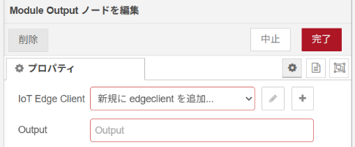

  | プロパティ      | Type       | Required | Conditions | default | Description                                                                                                         |
  | --------------- | ---------- | -------- | ---------- | ------- | ------------------------------------------------------------------------------------------------------------------- |
  | IoT Edge Client | edgeclient | 〇       |            |         | 送受信を行う client のグローバル設定を選択。<br>複数作成することができるが、1つの NodeRED 環境に 1 つあれば問題ない |
  | Output          | string     | 〇       |            |         | output 名                                                                                                           |

#### 使用例１

  [プロパティ]

  | プロパティ      | Type       | Value           |
  | --------------- | ---------- | --------------- |
  | IoT Edge Client | edgeclient | IoT Edge Client |
  | Output          | string     | output1         |

  [入力メッセージ]

  ```json
  {
    "payload": {
      "RecordList": [
        {
          "RecordHeader": ["005_017_JP0130100g30102_20240115.csv", "1"],
          "RecordData": ["2024-01-15 10:00:00", "1.234", "2.567", "25.8", "60.2"]
        }
      ]
    },
    "properties": {
      "propertyList": [
        { "key": "filename", "value": "005_017_JP0130100g30102_20240115.csv" },
        { "key": "row_number", "value": "1" },
        { "key": "row_total", "value": "2" },
        { "key": "$.cdid", "value": "Edge01" },
        { "key": "$.cmid", "value": "csvfilereceiver01" }
      ]
    }
  }
  ```

  [出力メッセージ]

  ```json
  {
    "deviceId": "Edge01",
    "moduleId": "gaudinodered01",
    "body": {
      "RecordList": [
        {
          "RecordHeader": ["005_017_JP0130100g30102_20240115.csv", "1"],
          "RecordData": ["2024-01-15 10:00:00", "1.234", "2.567", "25.8", "60.2"]
        }
      ]
    },
    "properties": {
      "filename": "005_017_JP0130100g30102_20240115.csv",
      "row_number": "1",
      "row_total": "2"
    }
  }
  ```

<a id="Node-Specification-module-twin"></a>

### Module Twin

#### 機能概要

Module Twinメッセージを受け取り、desiredプロパティに設定された値を出力する。

* GAUDI-NodeREDモジュールのdesiredプロパティ更新時にpayloadにdesiredプロパティをセットしてメッセージを出力する。  
* メッセージを受信するとreportedプロパティをIoTHubに送信する。  

※複数のModule Twinノードを配置した場合、ノードの数に比例して、初期起動時のログが増加するため、  
フローには、1つだけ配置することを推奨する。

#### プロパティ

  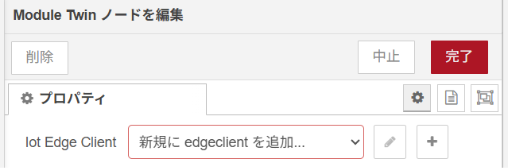

  | プロパティ      | Type       | Required | Conditions | default | Description                                                                                                              |
  | --------------- | ---------- | -------- | ---------- | ------- | ------------------------------------------------------------------------------------------------------------------------ |
  | IoT Edge Client | edgeclient | 〇       |            |         | 送受信を行う client のグローバル設定を選択。<br>複数作成することができるが、<br>1 つの NodeRED 環境に 1 つあれば問題ない |

#### 使用例１

  desiredプロパティ：testPropの設定値の更新を受けて処理を実行し、  
  ModuleTwinノードが起動状態であることをreportedプロパティへ書込みするフロー

  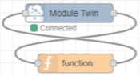

  [プロパティ]

  | プロパティ      | Type       | Value           |
  | --------------- | ---------- | --------------- |
  | IoT Edge Client | edgeclient | IoT Edge Client |

  [ModuleTwinノードからの出力メッセージ (desiredプロパティ更新を受信)]

  ```json
  {
    "payload": {
      "testProp": "test1",
      "$version": 5
    },
    "topic": "desired"
  }

  ```

  [functionノードからの入力メッセージ (reportedプロパティを送信)]

  ```json
  {
    "payload": {
      "moduleStatus": "running"
    }
  }
  ```

  [IoTHubでのreportedプロパティ取得結果]

  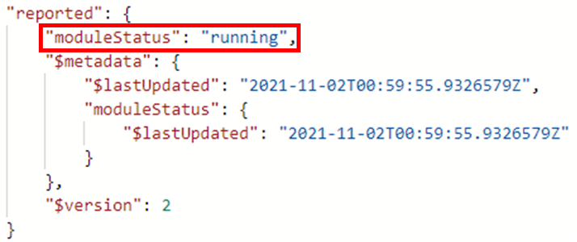

<a id="Node-Specification-module-method"></a>

### Module Method

#### 機能概要

* ダイレクトメソッドの入力ペイロードを出力する。
* 入力された情報をダイレクトメソッドの結果として返す。

(**注意**) ダイレクトメソッドを呼び出し後、レスポンスが返ってくる前にネットワークの切断が起きた場合、  
復旧タイミング次第でノードは成功ログを出力しているが呼び出し側は失敗判定となることがある。

#### プロパティ

  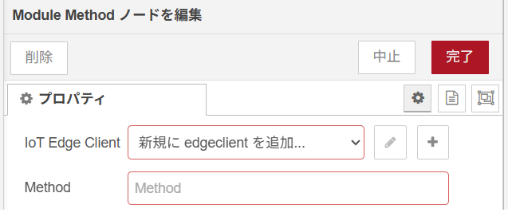

  | プロパティ      | Type       | Required | Conditions | default | Description                                                                                                              |
  | --------------- | ---------- | -------- | ---------- | ------- | ------------------------------------------------------------------------------------------------------------------------ |
  | IoT Edge Client | edgeclient | 〇       |            |         | 送受信を行う client のグローバル設定を選択。<br>複数作成することができるが、<br>1 つの NodeRED 環境に 1 つあれば問題ない |
  | Method          | string     | 〇       |            |         | ダイレクトメソッド名                                                                                                     |

#### 出力メッセージ (本ノードが受信したダイレクトメソッドの入力情報)

  | msg プロパティ | Required | Description                                           |
  | -------------- | -------- | ----------------------------------------------------- |
  | payload        | &emsp;   | ダイレクトメソッドの入力ペイロード<br>デフォルト null |
  | topic          | 〇       | 固定値 "method" ※1                                    |
  | method         | 〇       | 実行されたダイレクトメソッド名 ※1                     |
  | requestId      | 〇       | ダイレクトメソッドリクエストの一意識別子 ※1           |

　※1 ダイレクトメソッド実行時に自動で付与されるため設定は不要。

#### 入力メッセージ (ダイレクトメソッドの戻り値)

  | msg プロパティ | Required | Description                                             |
  | -------------- | -------- | ------------------------------------------------------- |
  | payload        | &emsp;   | 文字列でなければ自動で文字列化される<br>デフォルト null |
  | status         | 〇       | 数値                                                    |
  | requestId      | 〇       | ダイレクトメソッドリクエストの一意識別子※2              |

  ※2 出力メッセージのrequestIdの引き継ぎが必須であり、  
  変更または削除するとリクエストとレスポンスの受け合わせができなくなり、  
  正常にレスポンスが返せない。

#### 使用例１

  受信したペイロードのvalプロパティの数値を100倍して返すフロー

  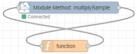

  [プロパティ]

  | プロパティ      | Type       | Value           |
  | --------------- | ---------- | --------------- |
  | IoT Edge Client | edgeclient | IoT Edge Client |
  | Method          | string     | multiplySample  |

  [ダイレクトメソッド実行画面]

  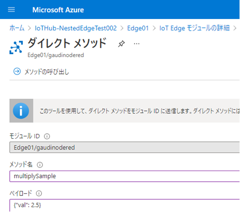

  [出力メッセージ (本ノードが受信したダイレクトメソッドの入力情報)]

  ```json
  {
    "payload": {
      "val": "2.5"
    },
    "topic": "method",
    "method": "multiplySample",
    "requestId": "20251017065025550_ykimjrvs9"
  }
  ```

  [入力メッセージ (ダイレクトメソッドの結果)]

  ```json
  {
    "status": 100,
    "payload": "{\"multiplyResult\":250}"
  }
  ```

  [ポータルでのダイレクトメソッド実行結果]

  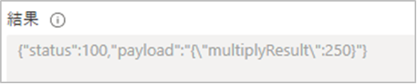

## ログ出力内容

<a id="log-iotedgeclient"></a>

### IoTEdgeClient

| LogLevel | 出力概要                                                                                                                      |
| -------- | ----------------------------------------------------------------------------------------------------------------------------- |
| error    | [クライアント作成/クライアント接続/ツイン取得/タイムアウト設定]失敗<br>クライアント切断<br>クライアントエラー                 |
| warn     | 無し                                                                                                                          |
| info     | クライアント[作成/接続/切断]<br>ツイン作成<br>メッセージサイズ上限拡張設定失敗、デフォルト値設定                              |
| debug    | タイムアウト値<br>エラーフィルター一覧<br>最大メッセージサイズ                                                                |
| trace    | ツイン内容<br>タイムアウト設定[開始/取得開始]<br>エラーフィルター[設定取得開始/設定]<br> メッセージサイズ上限拡張設定取得開始 |

<a id="log-module-input"></a>

### Module Input

| LogLevel | 出力概要                                                 |
| -------- | -------------------------------------------------------- |
| error    | クライアント取得失敗<br>受信メッセージ出力失敗※1         |
| warn     | 無し                                                     |
| info     | ノード作成<br>メッセージ受信<br>受信メッセージ出力失敗※2 |
| debug    | 無し                                                     |
| trace    | 受信メッセージ                                           |

※1 catchノードが存在する場合、ログ出力されない。  
※2 catchノードが存在する場合でもログ出力される。

<a id="log-module-output"></a>

### Module Output

| LogLevel | 出力概要                                             |
| -------- | ---------------------------------------------------- |
| error    | クライアント取得失敗<br>メッセージ送信失敗※1         |
| warn     | 無し                                                 |
| info     | ノード作成<br>メッセージ送信<br>メッセージ送信失敗※2 |
| debug    | 無し                                                 |
| trace    | 送信メッセージ                                       |

※1 catchノードが存在する場合、ログ出力されない。  
※2 catchノードが存在する場合でもログ出力される。

<a id="log-module-twin"></a>

### Module Twin

| LogLevel | 出力概要                                                                |
| -------- | ----------------------------------------------------------------------- |
| error    | ツイン取得失敗<br>メッセージ送信失敗※1                                  |
| warn     | 無し                                                                    |
| info     | desiredProperties更新<br>reportedProperties更新<br>メッセージ送信失敗※2 |
| debug    | 無し                                                                    |
| trace    | desiredProperties更新内容                                               |

※1 catchノードが存在する場合、ログ出力されない。  
※2 catchノードが存在する場合でもログ出力される。

<a id="log-module-method"></a>

### Module Method

| LogLevel | 出力概要                                                                                                 |
| -------- | -------------------------------------------------------------------------------------------------------- |
| error    | クライアント取得失敗<br>ダイレクトメソッド返信失敗※1                                                     |
| warn     | 無し                                                                                                     |
| info     | ノード作成<br>ダイレクトメソッドの実行開始<br>ダイレクトメソッド返信成功<br>ダイレクトメソッド返信失敗※2 |
| debug    | 無し                                                                                                     |
| trace    | 受信したダイレクトメソッドリクエストの詳細情報<br>ダイレクトメソッド受信処理完了の詳細情報               |

※1 catchノードが存在する場合、ログ出力されない。  
※2 catchノードが存在する場合でもログ出力される。

## エラー時動作一覧

### 共通

| 分類               | エラー内容                                                | 動作                               | 出力ログレベル |
| ------------------ | --------------------------------------------------------- | ---------------------------------- | -------------- |
| **環境変数**       | AzureIoTMaxOperationTimeoutがConditionsまたはType制約違反 | エラー出力。                       | error          |
| **ノード初期化**   | クライアントまたはツイン初期化未実施                      | エラー出力。                       | error          |
| **タイムアウト**   | クライアントまたはツイン接続失敗時                        | エラー出力。                       | error          |
| **edgeClient接続** | NW切断時                                                  | ModuleClient接続不可の例外出力。※1 | error          |

※1 NW切断時、エラーメッセージは出力されるがノードステータスはconnectedのままであるため、  
ノードステータスがconnectedで通信失敗している場合はログを確認すること。

<a id="error-module-input"></a>

### Module Input

| 分類               | エラー内容                                                       | 動作         | 出力ログレベル |
| ------------------ | ---------------------------------------------------------------- | ------------ | -------------- |
| **プロパティ設定** | Inputが同じ「Module Input」ノードを2つ以上設定してデプロイ       | エラー出力。 | error          |
| **メッセージ受信** | Inputが同じ「Module Input」ノードを2つ以上設定してメッセージ受信 | 例外出力。※1 | error          |

※1 出力した例外は、catchノードで受信可能。

<a id="error-module-output"></a>

### Module Output

| 分類               | エラー内容                                                                                | 動作         | 出力ログレベル |
| ------------------ | ----------------------------------------------------------------------------------------- | ------------ | -------------- |
| **メッセージ受信** | msg.payload, msg.propertiesの合計サイズがiothubトピックメッセージの上限サイズを超えている | 例外出力。※1 | error          |
| &emsp;             | プロパティリストの中身が空/オブジェクトではない/キーに"key"が無い/キーに"value"が無い     | 例外出力。※1 | error          |

※1 出力した例外は、catchノードで受信可能。

<a id="error-module-twin"></a>

### Module Twin

| 分類               | エラー内容                 | 動作         | 出力ログレベル |
| ------------------ | -------------------------- | ------------ | -------------- |
| **メッセージ受信** | reportedProperties更新失敗 | 例外出力。※1 | error          |

※1 出力した例外は、catchノードで受信可能。

<a id="error-module-method"></a>

### Module Method

| 分類               | エラー内容                                     | 動作         | 出力ログレベル |
| ------------------ | ---------------------------------------------- | ------------ | -------------- |
| **メッセージ受信** | ダイレクトメソッドの応答をIoTHubへの返信に失敗 | 例外出力。※1 | error          |
| **タイムアウト**   | 入力待ちタイムアウト※2                         | 例外出力。※1 | error          |

※1 出力した例外は、catchノードで受信可能。  
※2 ダイレクトメソッド実行のトリガーが発生し、約2分以内に「Module Method」ノードへ入力がない場合、  
「Module Method」ノードがエラーを出力する。

## Feedback

お気づきの点があれば、ぜひIssueにてお知らせください。

## LICENSE

node-red-iotedge is licensed under the MIT License, see the [LICENSE](LICENSE) file for details.